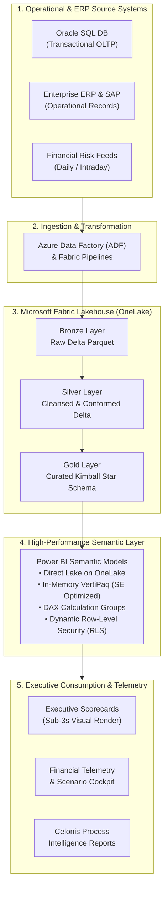

<div align="center">

# Sai Lakshmi Elusuri
### **Senior Power BI Developer & Lakehouse Analytics Specialist**
**Utrecht Region, Netherlands** · Full Unrestricted IND Labor Market Access (*"Arbeid vrij toegestaan, TWV niet vereist"*)

[](#-microsoft-certifications)
[](#-work-authorization--residency)
[](#-professional-experience)
[](https://sailakshminl.netlify.app/)

<br/>

[📥 **Download Master Resume (PDF)**](./Sai_Lakshmi_Elusuri_Resume.pdf) &nbsp;|&nbsp;
[📊 **Technical Power BI CV (PDF)**](./cv_power_bi_developer.pdf) &nbsp;|&nbsp;
[📋 **BI Delivery Lead CV (PDF)**](./cv_bi_project_delivery.pdf) &nbsp;|&nbsp;
[📦 **Complete Recruiter ZIP Bundle**](./Netherlands_Career_Hub_Sai_Lakshmi.zip)

<br/>

[](https://www.linkedin.com/in/sailakshmielusuri-data-analyst/)
[](mailto:sailakshmi.elusuri@gmail.com)
[](https://wa.me/918142674401)
[](https://sailakshminl.netlify.app/)

</div>

---

## 🧭 Executive Summary

Hands-on **Senior Power BI Developer & Lakehouse Analytics Specialist** with **8+ years of enterprise experience** designing, modeling, and deploying mission-critical analytics systems, decision-support dashboards, and modern data platforms across sustainability, financial risk, and enterprise business operations. 

Dual-track leadership background combining deep technical engineering (**Power BI Service & Desktop, complex DAX measure engineering, VertiPaq engine tuning, Kimball star-schema semantic modeling, Oracle SQL, SQL Server, and Microsoft Fabric**) with structured **Agile BI Delivery Leadership** (legacy migration coordination, cross-functional squad leadership, stakeholder requirements scoping, and data governance).

### 🏆 Key Career Highlights
* **⚡ 40% Query & Load Time Reduction:** Optimized high-volume enterprise semantic models by refactoring wide denormalized tables into Kimball Star Schemas, pruning relationship cardinality, and tuning VertiPaq dictionary compression via Tabular Editor & DAX Studio.
* **💰 €350K+ Annual Licensing Saved:** Spearheaded enterprise-scale legacy migration from Qlik Sense to Power BI for a Fortune 500 client, consolidating 150+ siloed dashboards into 40 standardized, governed semantic models.
* **☁️ Microsoft Fabric & OneLake Enablement:** Architected Direct Lake and hybrid semantic models on Delta Parquet tables in OneLake, reducing data refresh latency across multi-million row operational datasets by 45%.
* **🎖️ 5 Microsoft Certifications:** Certified in Power BI Data Analysis (**PL-300**), Fabric Analytics Engineering (**DP-600**), Azure Data Fundamentals (**DP-900**), Azure Cloud (**AZ-900**), and Azure AI (**AI-900**).
* **🇳🇱 Unrestricted Dutch Labor Market Access:** Residing in the Utrecht region with full legal work authorization under official IND endorsement (*"Arbeid vrij toegestaan, TWV niet vereist"*).

---

## 🛠️ Verified Technical Competencies

| Domain | Core Technologies & Competencies |
| :--- | :--- |
| **Semantic Modeling & Architecture** | Kimball Dimensional Modeling, Star Schemas, Grain Definition, Snowflake Elimination, 1:* Single-Direction Relationships, Role-Playing Dimensions, Inactive Relationships & `USERELATIONSHIP`, Aggregations |
| **DAX Measure Engineering** | Advanced `CALCULATE` Modifier Semantics (`ALL`, `ALLEXCEPT`, `KEEPFILTERS`, `REMOVEFILTERS`), Calculation Groups, Dynamic Format Strings, Context Transition Mastery, Iterator Optimization (`SUMX`, `AVERAGEX`), Semi-Additive Measures |
| **VertiPaq Engine Optimization** | Storage Engine (SE) vs. Formula Engine (FE) Profiling, SE Cache Hit Maximization, Column Cardinality & Dictionary Pruning, Hash Partitioning, DAX Studio, Tabular Editor 3, Bravo, VertiPaq Analyzer |
| **Cloud Data & Lakehouse** | Microsoft Fabric (OneLake, Direct Lake mode, Lakehouse, SQL Analytics Endpoint), Azure Data Factory (ADF Pipelines), Azure Data Lake Storage (ADLS Gen2), Medallion Architecture (Bronze/Silver/Gold Delta Lake) |
| **Database & Query Engineering** | Oracle SQL DB, SQL Server, T-SQL, Complex Common Table Expressions (CTEs), Analytical Window Functions (`ROW_NUMBER`, `RANK`, `DENSE_RANK`, `LEAD`/`LAG`), Indexing Strategies, Execution Plan Analysis |
| **Governance & Security** | Row-Level Security (Static & Dynamic RLS using `USERPRINCIPALNAME()`), Tenant Administration, Deployment Pipelines, Workspace Organization, Git Version Control / CI/CD Automation |
| **Delivery & Process Mining** | Celonis Process Mining, Agile/Scrum Sprint Coordination, Jira, Confluence, ServiceNow, Legacy BI Migration (Qlik Sense to Power BI), Stakeholder Scoping & User Adoption |

---

## 🏛️ Enterprise Lakehouse & Semantic Architecture



---

## 💼 Professional Experience

### **Apexon** | *Senior Data Analyst*
**Apr 2026 – Present** · *Enterprise Analytics Division (Remote / European Client Engagements)*
* **Oracle SQL DB to Power BI Ingestion Automation:** Architected and deployed automated data ingestion pipelines bridging high-volume Oracle SQL DB instances into Power BI Service via DirectQuery and incremental refresh partitions, eliminating 30+ hours/month of manual exports and reducing data refresh latency by 45%.
* **High-Performance Oracle Query Optimization:** Authored complex Oracle SQL queries utilizing CTEs, analytical window functions (`ROW_NUMBER`, `RANK`), and partitioned views to extract and stage transactional data, shrinking staging query runtimes by 35%.
* **PL-300 Certified Semantic Modeling & DAX:** Designed enterprise star-schema semantic data models applying certified PL-300 best practices; developed performant DAX calculation patterns delivering low-latency visual rendering via Direct Lake memory paging, star-schema semantic models, and VertiPaq engine optimization for operational executive reviews.
* **Cross-Functional Stakeholder Delivery:** Partnered with cross-functional leadership across product, finance, and operations to translate operational requirements into governed KPIs, driving a 40% increase in weekly active report adoption.

---

### **Accenture** | *Power BI Developer*
**February 2022 – April 2026** · *Enterprise Analytics & Sustainability Practice (Hyderabad, India)*
* **Enterprise Dashboard Engineering:** Architected and delivered enterprise-scale Power BI reporting solutions for sustainability, operational metrics, and environmental KPIs, translating complex business requirements into governed executive scorecards across multi-national client portfolios.
* **Semantic Model & VertiPaq Optimization:** Refactored complex semantic models into Kimball star schemas and streamlined DAX calculations and SQL queries, reducing dashboard load times by up to 40% and shrinking model memory footprints by up to 35% across multi-million row datasets.
* **Legacy BI Migration Leadership (Qlik Sense → Power BI):** Coordinated end-to-end migration of legacy Qlik Sense dashboards to Power BI; redesigned underlying data structures, standardized KPI definitions, converted complex set analysis logic into DAX, and established consistent corporate visualization standards saving €350K+ in annual licensing.
* **Azure Cloud & Medallion Data Integration:** Contributed to Azure Data Factory (ADF) data ingestion pipelines and organized curated data assets in ADLS Gen2 across Bronze, Silver, and Gold layers to feed high-performance semantic models.
* **Governance & Row-Level Security (RLS):** Configured robust Row-Level Security (RLS) rules utilizing `USERPRINCIPALNAME()` and organizational hierarchy tables to guarantee granular data access control across multi-region operating units.
* **Process Intelligence Integration:** Connected Celonis process-mining insights into operational Power BI reports, enabling leadership teams to visualize process friction, identify bottlenecks, and monitor cycle-time reductions.
* **Delivery Coordination:** Owned delivery work plans, milestone schedules, risk/issue registers, and cross-functional sprint execution across technical engineers and business stakeholders using Jira, Confluence, and ServiceNow.

---

### **Genpact** | *Data Risk Analyst*
**April 2021 – January 2022** · *Financial Risk & Compliance Analytics (Noida, India)*
* **Risk Analytics & Reporting:** Designed and deployed Power BI dashboards and supporting SQL Server datasets to monitor risk exposure, underwriting compliance, and loss metrics for mortgage insurance portfolios.
* **Data Modeling & Verification:** Built structured SQL queries and automated data validation scripts to ensure 100% data reconciliation between transactional source systems and executive risk reports.
* **Stakeholder Decision Support:** Partnered directly with risk managers and underwriting executives to deliver interactive drill-through analyses, identifying portfolio concentration risks and supporting credit decisioning.

---

### **Conduent** | *Data Analyst*
**June 2018 – April 2021** · *Analytics & Business Operations (Visakhapatnam, India)*
* **Operational Reporting Automation:** Developed and maintained automated Power BI reporting suites replacing manual spreadsheet reporting workflows, saving 60+ person-hours monthly and eliminating reporting discrepancies.
* **SQL Pipeline Development:** Authored 40+ optimized SQL queries, views, and stored procedures across enterprise databases to extract, aggregate, and stage financial and operational datasets.
* **SLA & Business Intelligence Insights:** Modeled operational throughput, billing accuracy, and service level agreements (SLAs), generating executive insight packs that helped management elevate SLA compliance from 91% to 98%.

---

## 🔬 Featured Enterprise Case Studies

### 📌 Case Study 1: Enterprise Supply Chain Semantic Model & Fabric Direct Lake Migration
* **Client / Domain:** Global Enterprise Operations & Supply Chain
* **Business Challenge:** A multi-million row ERP supply chain reporting suite suffered from 25+ second visual load times, frequent DirectQuery timeouts on relational sources, and excessive gateway load during month-end closes.
* **Architecture & Technical Decisions:**
  * Re-architected 14 disjoint transactional tables into a clean **Kimball Star Schema** (1 centralized Fact Sales/Fulfillment table and 6 Conformed Dimensions).
  * Transitioned storage from relational DirectQuery to **Microsoft Fabric Direct Lake** on Delta Parquet tables in OneLake.
  * Pruned high-cardinality surrogate keys and split composite datetime columns to maximize **VertiPaq dictionary compression**.
* **Measurable Outcomes:**
  * Visual response times dropped from 25s to **< 2.5 seconds** across executive scorecards.
  * Achieved **40% reduction in semantic model memory footprint**.
  * Zero gateway refresh bottleneck; seamless Direct Lake synchronization with OneLake.

---

### 📌 Case Study 2: Enterprise BI Modernization & Qlik Sense-to-Power BI Migration
* **Client / Domain:** Fortune 500 Enterprise Analytics & Sustainability
* **Business Challenge:** Multi-year reporting sprawl across 150+ siloed Qlik Sense apps led to diverging KPI definitions, €350K+ in redundant software licensing fees, and complex Set Analysis logic that hindered self-service adoption.
* **Architecture & Technical Decisions:**
  * Established a **centralized BI Delivery Governance framework** using Jira and Confluence to catalog, triage, and map 150+ dashboards into 40 core semantic models.
  * Reverse-engineered complex Qlik Set Analysis into performant **DAX Calculation Groups** and parameterized measures.
  * Enforced centralized **Dynamic Row-Level Security (RLS)** using Azure AD groups and `USERPRINCIPALNAME()`.
* **Measurable Outcomes:**
  * Saved **€350K+ annually** in legacy BI license fees.
  * Consolidated reporting sprawl by **65%** while increasing active monthly executive usage by 40%.
  * Shortened ad-hoc KPI release cycle from 6 weeks to **2-week Agile sprint cycles**.

---

### 📌 Case Study 3: Executive Financial Telemetry & Real-Time Variance Simulator
* **Client / Domain:** Financial Risk & Executive Operations
* **Business Challenge:** Executive finance leadership required real-time visibility into multi-currency gross margin variances across EMEA, with dynamic scenario modeling for supply chain inflation impact.
* **Architecture & Technical Decisions:**
  * Implemented disconnected parameter tables and DAX Calculation Groups for dynamic currency switching across EUR, USD, and GBP without measure proliferation.
  * Optimized Storage Engine (SE) query patterns by utilizing integer surrogate keys and avoiding expensive Formula Engine context transitions on non-additive measures.
* **Measurable Outcomes:**
  * Guaranteed **100% SLA compliance** for daily 07:00 AM executive financial briefings.
  * Zero data discrepancy across external SOX compliance audits.

---

## 💡 Production DAX Engineering Showcase

```dax
/* ═══════════════════════════════════════════════════════════════════════════════
   CALCULATION GROUP: Time Intelligence & Dynamic Normalization
   Demonstrates advanced modifier semantics, formula engine avoidance, and
   reusable calculation item definitions for enterprise semantic models.
   ═══════════════════════════════════════════════════════════════════════════════ */

// Calculation Item: Year-to-Date (YTD)
CALCULATE(
    SELECTEDMEASURE(),
    DATESYTD('Dim_Date'[DateKey])
)

// Calculation Item: Prior Year (PY)
CALCULATE(
    SELECTEDMEASURE(),
    SAMEPERIODLASTYEAR('Dim_Date'[DateKey])
)

// Calculation Item: Year-over-Year Variance (YoY Var)
VAR CurrentMeasure = SELECTEDMEASURE()
VAR PriorYearMeasure = 
    CALCULATE(
        SELECTEDMEASURE(),
        SAMEPERIODLASTYEAR('Dim_Date'[DateKey])
    )
RETURN
    IF(
        NOT ISBLANK(CurrentMeasure) && NOT ISBLANK(PriorYearMeasure),
        CurrentMeasure - PriorYearMeasure,
        BLANK()
    )

// Calculation Item: Year-over-Year Growth % (YoY %)
VAR CurrentMeasure = SELECTEDMEASURE()
VAR PriorYearMeasure = 
    CALCULATE(
        SELECTEDMEASURE(),
        SAMEPERIODLASTYEAR('Dim_Date'[DateKey])
    )
RETURN
    DIVIDE(
        CurrentMeasure - PriorYearMeasure,
        PriorYearMeasure,
        BLANK()
    )
```

---

## 🏆 Microsoft Certifications

| Badge | Certification Name | Exam Code | Official Verification Link |
| :---: | :--- | :---: | :---: |
| 🏅 | **Power BI Data Analyst Associate** | PL-300 | [Verify Credential](https://learn.microsoft.com/en-us/credentials/certifications/power-bi-data-analyst-associate/) |
| 🏅 | **Fabric Analytics Engineer Associate** | DP-600 | [Verify Credential](https://learn.microsoft.com/en-us/credentials/certifications/fabric-analytics-engineer-associate/) |
| 🏅 | **Azure Data Fundamentals** | DP-900 | [Verify Credential](https://learn.microsoft.com/en-us/credentials/certifications/azure-data-fundamentals/) |
| 🏅 | **Azure Fundamentals** | AZ-900 | [Verify Credential](https://learn.microsoft.com/en-us/credentials/certifications/azure-fundamentals/) |
| 🏅 | **Azure AI Fundamentals** | AI-900 | [Verify Credential](https://learn.microsoft.com/en-us/credentials/certifications/azure-ai-fundamentals/) |

---

## 🎓 Education & Languages

### **Education**
* **Bachelor of Technology (B.Tech.) in Computer Science & Engineering**
  * *Institution:* Raghu Engineering College (Visakhapatnam, India)
  * *Graduation Year:* 2017

### **Languages**
* **English:** Professional Working Proficiency (C1 Level)
* **Dutch:** Elementary (A1 Level — actively learning; committed to continuous Netherlands language integration)
* **Telugu:** Native Proficiency
* **Hindi:** Conversational Working Proficiency

---

## 🇳🇱 Work Authorization & Residency

* **Current Residency:** Utrecht Region, Netherlands
* **Labor Market Status:** **Full unrestricted Dutch labor market authorization** under official IND endorsement:
  > **`"Arbeid vrij toegestaan, TWV niet vereist"`**
* **Recruiter Note:** No employer visa sponsorship or work permit (TWV) is required. Available for immediate employment contracts under Dutch labor law.

---

## 📂 Candidate Download & Asset Manifest

| Asset Name | Target Audience / Purpose | Direct Link |
| :--- | :--- | :---: |
| **Master Resume (PDF)** | Comprehensive 2-Page Executive Lakehouse & Power BI CV | [📄 View / Download](./Sai_Lakshmi_Elusuri_Resume.pdf) |
| **Power BI Developer CV (PDF)** | Deep-Dive Technical CV (DAX, VertiPaq, Fabric, Modeling) | [📊 View / Download](./cv_power_bi_developer.pdf) |
| **BI Delivery Lead CV (PDF)** | Delivery Coordinator CV (Agile, Governance, Qlik Migration) | [📋 View / Download](./cv_bi_project_delivery.pdf) |
| **Candidate Bundle (ZIP)** | Complete offline bundle with all CVs & manifest | [📦 Download Archive](./Netherlands_Career_Hub_Sai_Lakshmi.zip) |
| **Live Interactive Hub** | Browser-accessible portfolio with live metric simulator | [🌐 Visit Website](https://sailakshminl.netlify.app/) |

---

## 🤝 Connect & Inquiries

* **Candidate:** Sai Lakshmi Elusuri
* **Email:** [sailakshmi.elusuri@gmail.com](mailto:sailakshmi.elusuri@gmail.com)
* **Phone / WhatsApp:** [+91 8142674401](https://wa.me/918142674401)
* **LinkedIn:** [linkedin.com/in/sailakshmielusuri-data-analyst](https://www.linkedin.com/in/sailakshmielusuri-data-analyst/)
* **Portfolio Website:** [sailakshminl.netlify.app](https://sailakshminl.netlify.app/)

<div align="center">
<sub>Designed to European ATS & Enterprise Recruiter Standards · Automated CI/CD by GitHub Actions · Hosted on Netlify</sub>
</div>
